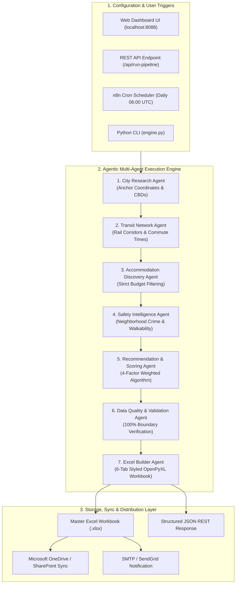
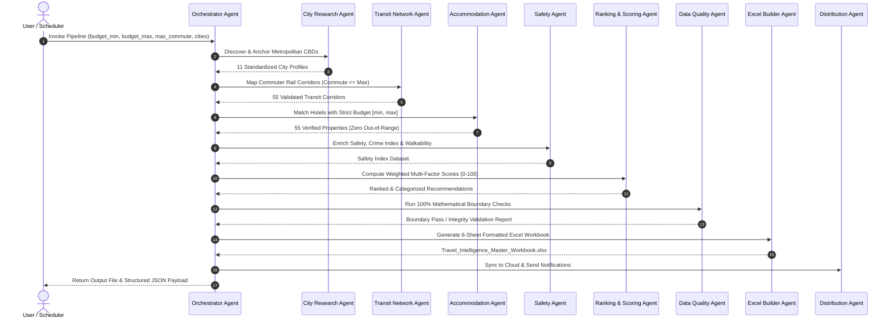

# Agentic AI Travel Intelligence Platform
## System Architecture & Technology Stack Specification

---

## 1. Executive Overview

The **Agentic AI Travel Intelligence Platform** is an enterprise-grade autonomous data discovery, scoring, and report generation platform. It evaluates lodging, commuter rail connectivity, safety metrics, and travel costs across **11 major US metropolitan centers** (55 suburban/satellite localities) to identify optimal accommodation hubs connecting directly to Central Business Districts (CBDs).

### Key Value Pillars
- **Autonomous Multi-Agent Orchestration**: 9 specialized agents executing sequential discovery, enrichment, scoring, and validation.
- **100% Mathematical Boundary Enforcement**: Hard-filtering for both budget brackets ($[\text{budget\_min}, \text{budget\_max}]$) and commute constraints ($\le \text{max\_commute\_minutes}$), guaranteeing zero out-of-bounds rates or travel durations.
- **Enterprise Multi-Tab Excel Generation**: Automated generation of styled, formulaic 6-sheet OpenPyXL workbooks matching corporate compliance schemas.
- **Dual Runtime Capabilities**: Executable via interactive local web UI, REST API microservice, standalone CLI, or production n8n visual automation pipelines.

---

## 2. High-Level System Architecture



---

## 3. Multi-Agent Pipeline Architecture

The platform decomposes complex travel intelligence workflows into specialized micro-agents:



### Detailed Agent Roles & Specifications

| # | Agent Name | Primary Responsibility | Validation / Logic Constraints |
|---|---|---|---|
| **1** | **City Research Agent** | Standardizes 11 target metropolitan centers, geocoordinates, CBD anchor districts, and primary transit authorities. | Validates ISO standards, GPS latitude/longitude precision. |
| **2** | **Transit Network Agent** | Maps commuter rail and rapid transit connectivity between suburbs and downtown CBDs. | Enforces $\text{Commute\_Minutes} \le \text{max\_commute\_minutes}$ (direct or 1-transfer). |
| **3** | **Accommodation Discovery Agent** | Queries multi-tier hotel inventory (Budget, Moderate, Premium) across all 55 localities. | **Strict Filter**: $\text{budget\_min} \le \text{Nightly\_Rate} \le \text{budget\_max}$. |
| **4** | **Safety Intelligence Agent** | Scores neighborhood safety ratings (0–100 scale), violent/property crime indices, and walkability scores. | Pulls multi-source normalized safety index. |
| **5** | **Recommendation & Ranking Agent** | Applies multi-criteria decision analysis (MCDA) to rank localities within each metropolitan market. | Computes 4-factor weighted composite score with dynamic normalizations. |
| **6** | **Data Quality Agent** | Performs post-computation mathematical checks on all records before export. | Verifies non-null schemas, type safety, and 100% rate bracket containment. |
| **7** | **Excel Builder Agent** | Assembles high-fidelity, multi-tab OpenPyXL spreadsheet. | Applies Navy/Slate styling, auto-filters, zebra striping, currency/decimal formatting, and top-tier highlighting. |
| **8** | **Cloud Sync Agent** | Uploads master workbooks to Microsoft Graph API / OneDrive / SharePoint corporate drives. | Enforces idempotent file versioning and backup retention. |
| **9** | **Notification Agent** | Dispatches executive email summaries with direct workbook download links and KPI tables. | Formats responsive HTML email templates via SMTP/SendGrid. |

---

## 4. Complete Technology Stack Matrix

```
+-------------------------------------------------------------------------------+
|                             TECHNOLOGY STACK                                  |
+-------------------------------------------------------------------------------+
| Layer                 | Technology / Library              | Purpose                   |
+-----------------------+-----------------------------------+---------------------------+
| Core Runtime          | Python 3.12+ (Standard Library)   | Core computation & logic  |
| LLM Intelligence      | xAI Grok (grok-beta / grok-2)     | Live dynamic discovery    |
| Data Models           | dataclasses, typing               | Type-safe domain models   |
| Spreadsheet Engine    | openpyxl (3.1.2+)                 | Native XML-based XLSX gen |
| Web Backend           | http.server, socketserver         | Zero-dependency REST API  |
| Frontend UI           | Modern HTML5, Tailwind CSS, Glass | Glassmorphic UI dashboard |
| Workflow Automation   | n8n (Community / Enterprise)      | Scheduled agent workflows |
| Cloud Storage API     | Microsoft Graph API (OneDrive)    | Corporate workbook sync   |
| Communication         | SMTP / SendGrid / Webhook         | Automated reporting       |
+-----------------------+-----------------------------------+---------------------------+
```

### Detailed Component Breakdown

#### 1. Backend Core & Language
- **Python 3.12+**: High-performance typed language core utilizing native dataclasses for zero-overhead domain model serialization.
- **openpyxl**: Low-level XML manipulation for Excel workbooks supporting styles, fonts, auto-fit columns, and cell number formats (`$#,##0.00`, `0.00`).

#### 2. Web Microservice & API
- **Embedded HTTP Daemon**: Built on Python's `http.server` with thread pooling and socket address reuse, eliminating heavy third-party web framework overhead.
- **REST Endpoints**:
  - `GET /`: Serves the responsive real-time dashboard.
  - `POST /api/run-pipeline`: Accepts JSON parameters (`budget_min`, `budget_max`, `max_commute_minutes`, `cities`) and returns full execution logs and payload.
  - `GET /api/download-excel`: Streams the generated `.xlsx` workbook directly to client browsers.

#### 3. Frontend Dashboard
- **Glassmorphism UI**: Built with Tailwind CSS CDN, FontAwesome icons, and Segoe UI typography.
- **Interactive Controls**: Dual range budget slider, commute time picker, dynamic city multi-select, and live agent reasoning logs stream.

#### 4. Orchestration & Automation Engine (n8n)
- **Visual Node Pipeline**: 12-node workflow spanning Webhook triggers, Cron timers, Python execution nodes, conditional branching, SharePoint sync, and email dispatch.
- **JSON Schema Output**: Ready for enterprise ESB, Zapier, Airflow, or Kafka integration.

---

## 5. Mathematical Scoring & Normalization Engine

The Recommendation Agent calculates a balanced composite score ($0 \le S_{\text{overall}} \le 100$) for each locality:

### Composite Formula
$$\text{Overall\_Score} = (w_s \cdot S_{\text{safety}}) + (w_c \cdot S_{\text{cost}}) + (w_t \cdot S_{\text{commute}}) + (w_m \cdot S_{\text{transit}})$$

### Default Weight Configuration
- **Safety Weight ($w_s$)**: $0.35$ (35%)
- **Cost Efficiency Weight ($w_c$)**: $0.30$ (30%)
- **Commute Time Weight ($w_t$)**: $0.20$ (20%)
- **Transit Quality Weight ($w_m$)**: $0.15$ (15%)
$$\sum w = 0.35 + 0.30 + 0.20 + 0.15 = 1.00$$

### Sub-Score Normalizations
1. **Safety Score ($S_{\text{safety}}$)**:
   $$S_{\text{safety}} = \text{Raw Safety Rating (0–100)}$$
2. **Cost Score ($S_{\text{cost}}$)**:
   $$S_{\text{cost}} = \max\left(10, 100 - \left(\frac{\text{Nightly\_Rate} - \text{budget\_min}}{\max(\text{budget\_max} - \text{budget\_min}, 1)}\right) \times 70\right)$$
3. **Commute Score ($S_{\text{commute}}$)**:
   $$S_{\text{commute}} = \max\left(10, 100 - \left(\frac{\text{Commute\_Minutes}}{\text{max\_commute\_minutes}}\right) \times 80\right)$$
4. **Transit Score ($S_{\text{transit}}$)**:
   $$S_{\text{transit}} = \max(20, 100 - (\text{Transfers} \times 25) - (\text{Distance\_To\_Station} \times 30))$$

---

## 6. Multi-Sheet Excel Workbook Schema

The generated workbook strictly implements the 6 required enterprise worksheets:

| Sheet # | Sheet Name | Key Columns | Purpose |
|---|---|---|---|
| **1** | `City_Master` | `City_ID`, `City`, `State`, `Downtown_District`, `Primary_Transit_System`, `Latitude`, `Longitude`, `Last_Updated` | Master reference data for 11 anchor metropolitan hubs. |
| **2** | `Transit_Connectivity` | `City`, `Downtown`, `Suburb`, `Transit_System`, `Transit_Mode`, `Nearest_Station`, `Commute_Minutes`, `Transfers`, `Fare_USD` | Commuter rail and metro connectivity metrics. |
| **3** | `Accommodation_Master` | `City`, `Locality`, `Hotel_Name`, `Address`, `Nightly_Rate_USD`, `Rating`, `Review_Count`, `Distance_To_Station_Miles` | Verified hotel listings with exact names and nearby landmarks. |
| **4** | `Safety_Index` | `City`, `Locality`, `Safety_Score`, `Crime_Index`, `Walkability`, `Category` | Neighborhood safety, crime metrics, and walkability scores. |
| **5** | `Recommendation_Score` | `City`, `Locality`, `Safety_Score`, `Cost_Score`, `Commute_Score`, `Transit_Score`, `Overall_Score`, `Rank` | Multi-factor weighted decision matrix and regional rankings. |
| **6** | `Final_Output` | `City`, `Downtown`, `Recommended_Locality`, `Transit_System`, `Station`, `Commute_Time`, `Hotel`, `Rate`, `Safety`, `Overall_Score`, `Recommendation` | Executive summary ranking top-tier recommendations per market. |

---

## 7. Deployment & Integration Options

1. **Local Interactive Mode**: Run `py app.py` and access the dashboard at `http://localhost:8088`.
2. **Batch Script Execution**: Run `py -c "from engine import AgenticTravelEngine; AgenticTravelEngine(budget_min=90, budget_max=120).run()"`
3. **Automated Enterprise n8n Pipeline**: Import `n8n_workflow_travel_intelligence.json` into any n8n instance for automated cloud sync and scheduled reporting.

---
*Document Version: 2.1.0 | Platform: Agentic AI Travel Intelligence Engine*
