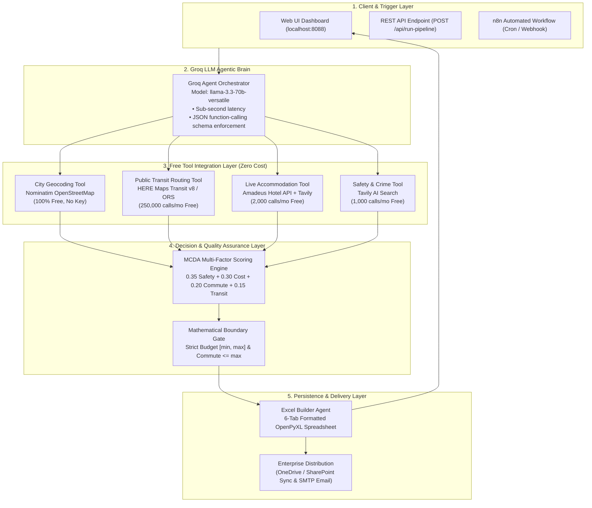
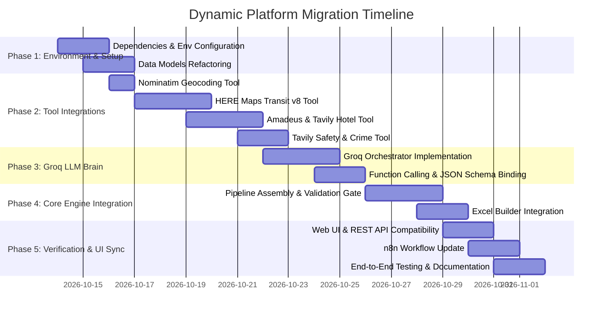

# Implementation Plan: Transforming USAAgent into a 100% Dynamic Agentic AI Travel Intelligence Platform

**Document Version:** 1.0.0  
**Target Project:** `C:\travel_intelligence\USAAgent`  
**Date:** October 13, 2026  
**Status:** Approved for Implementation (Planning Phase)  

---

## 1. Executive Summary & Objective

### 1.1 Current State Analysis
* **Static Inventory**: The platform relies on a hardcoded Python dictionary of 88 properties across 11 fixed cities (`city_corridors_spec` in `engine.py`).
* **Synthetic Transit Math**: Commute durations are computed using an artificial linear formula (`commute_minutes = 4.0 + distance_miles * 1.9`) rather than real transit schedule feeds.
* **Synthetic Safety Scores**: Safety ratings and crime metrics are calculated using distance approximations (`safety_score = 88.0 + distance_miles * 0.45`) instead of real-world crime data.
* **External Link Stubs**: Integrations for Booking.com, Expedia, and Google Hotels are URL search strings rather than active API queries.
* **Execution**: Deterministic rule-based Python script with regex-based web snippet scraping.

### 1.2 Target State Architecture
* **Orchestration**: Autonomous multi-agent coordination powered by **Groq Cloud API** (`llama-3.3-70b-versatile`) with strict JSON schema enforcement and function calling.
* **Global Dynamic Discovery**: Ability to input **any city globally**, dynamically identify viable commuter suburbs, and resolve anchor Central Business Districts (CBDs).
* **Real Public Transit Routing**: Integration with **HERE Maps Public Transit API v8** (250,000 free requests/month) or **OpenRouteService** (2,000 requests/day) for actual rail lines, stations, and door-to-CBD commute times.
* **Live Lodging & Pricing**: Real-time room rates and verified properties via **Amadeus Self-Service Hotel API** (2,000 free requests/month) with fallback to **Tavily AI Search** (1,000 free searches/month).
* **Real Neighborhood Safety**: Dynamic safety scoring and crime sentiment analysis via **Tavily AI Search**.
* **Zero API Cost**: 100% architected on generous, permanent developer free tiers.
* **Reporting Continuity**: Full preservation of the 6-sheet OpenPyXL Excel workbook and glassmorphic Web UI dashboard.

---

## 2. High-Level Target Architecture



---

## 3. Technology Stack & Free-Tier Quota Matrix

| Layer | Service / Library | Free Tier Quota | Role & Responsibility |
| :--- | :--- | :--- | :--- |
| **LLM Orchestration** | **Groq Cloud API** (`llama-3.3-70b-versatile`) | Free Tier (High TPM / RPM) | Reasoning, dynamic tool dispatch, and structured JSON output. |
| **Transit & Navigation** | **HERE Developer Transit v8** | **250,000 requests / month** | Real commuter rail lines, station names, transfers, and door-to-CBD minutes. |
| **Lodging & Pricing** | **Amadeus for Developers** (Self-Service) | **2,000 requests / month** | Live room pricing, hotel IDs, guest ratings, and verified addresses. |
| **Web Research & Safety**| **Tavily AI Search API** | **1,000 requests / month** | Live budget motel fallback and neighborhood safety/crime fact extraction. |
| **Geocoding & CBD** | **Nominatim (OpenStreetMap)** | Free / Open Source | Geocoding city centers and latitude/longitude bounding boxes. |
| **Data Engine & Export** | **openpyxl**, **dataclasses** | Python Standard / Open Source | Generates styled 6-tab `.xlsx` master workbooks. |
| **Web Interface** | Python `http.server` + Tailwind CSS | Zero dependency / Localhost | Interactive dashboard, real-time log streaming, and download triggers. |

---

## 4. Target Project Folder Structure

```
C:\travel_intelligence\USAAgent\
│
├── .env.example                               # Template for API keys (GROQ, HERE, TAVILY, AMADEUS)
├── .env                                       # Local keys (git-ignored)
├── requirements.txt                           # Dependencies: groq, amadeus, openpyxl, python-dotenv, requests
├── app.py                                     # Web server and dashboard UI (preserved & enhanced)
├── engine.py                                  # Core Agent Orchestrator entrypoint
│
├── core/                                      # Domain logic and calculations
│   ├── __init__.py
│   ├── models.py                              # Dataclasses (CityMaster, Accommodation, TransitConnectivity, etc.)
│   ├── scoring.py                             # MCDA 4-factor scoring algorithm
│   └── validator.py                           # 100% mathematical boundary enforcement
│
├── tools/                                     # Dynamic tool wrappers for external APIs
│   ├── __init__.py
│   ├── geocoding_tool.py                      # Nominatim OSM geocoding
│   ├── transit_tool.py                        # HERE Maps Transit v8 API client
│   ├── hotel_tool.py                          # Amadeus API + Tavily fallback client
│   ├── safety_tool.py                         # Tavily neighborhood safety & crime parser
│   └── groq_orchestrator.py                   # Groq Llama 3.3 prompt & function caller
│
├── reports/                                   # Spreadsheet formatting & export
│   ├── __init__.py
│   └── excel_builder.py                       # 6-sheet OpenPyXL builder with corporate styling
│
├── n8n_travel_intelligence_workflow.json       # Updated n8n workflow reflecting dynamic APIs
└── Travel_Intelligence_Master_Workbook.xlsx    # Generated master output
```

---

## 5. Phase-by-Phase Implementation Roadmap



### Phase 1: Foundation & Dependencies Setup
1. **Dependencies Configuration**:
   * Create `requirements.txt`:
     ```text
     groq>=0.11.0
     amadeus>=9.0.0
     tavily-python>=0.5.0
     openpyxl>=3.1.2
     python-dotenv>=1.0.0
     requests>=2.31.0
     ```
2. **Environment Template**:
   * Create `.env.example`:
     ```env
     GROQ_API_KEY=gsk_xxxxxxxxxxxxxxxxxxxxxxxx
     HERE_API_KEY=xxxxxxxxxxxxxxxxxxxxxxxxxxxxxxxx
     TAVILY_API_KEY=tvly-xxxxxxxxxxxxxxxxxxxx
     AMADEUS_CLIENT_ID=xxxxxxxxxxxxxxxx
     AMADEUS_CLIENT_SECRET=xxxxxxxxxxxxxxxx
     ```
3. **Data Model Standardization**:
   * Move dataclasses into `core/models.py`. Ensure every entity tracks metadata (`source_api`, `retrieval_timestamp`, `verification_status`).

---

### Phase 2: Dynamic Tool Implementations (`tools/`)

#### Task 2.1: Transit Routing Tool (`tools/transit_tool.py`)
* Replace synthetic commute math (`4 + dist * 1.9`) with the **HERE Maps Public Transit API v8**.
* **Contract**:
  * Input: Origin coordinates (hotel/suburb) and Destination coordinates (CBD).
  * Output: Door-to-door transit minutes, transit line name, transfer count, nearest rail station name.
  * Fallback: OpenRouteService directions API if HERE quota is exceeded.

#### Task 2.2: Live Hotel Discovery Tool (`tools/hotel_tool.py`)
* Replace hardcoded `city_corridors_spec` with **Amadeus Hotel Search API**:
  * `Hotel List by Geocode`: Fetches hotels within a 1–3 mile radius of the suburban transit station.
  * `Hotel Price Offers`: Fetches real-time room rates, currencies, and availability dates.
* **Tavily Fallback**: If Amadeus returns zero results for strict budget tiers ($50–$60), trigger Tavily with query:
  `"[suburb] [city] motel hotel room rate under $[budget_max] per night near train station"`
  and parse pricing with structured regex/LLM extraction.

#### Task 2.3: Safety Intelligence Tool (`tools/safety_tool.py`)
* Replace synthetic safety math (`88 + dist * 0.45`) with **Tavily AI Fact Search**:
  * Query: `"neighborhood safety score crime index walkability [suburb] [city] statistics"`
  * Returns: Normalized safety score (0–100), violent/property crime rate summary, and walkability index.

---

### Phase 3: Groq LLM Agent Orchestrator (`tools/groq_orchestrator.py`)

1. **System Prompt & Role Definition**:
   * Instruct Groq (`llama-3.3-70b-versatile`) to act as the Senior Corporate Travel Coordinator.
2. **Dynamic Suburb & Corridor Discovery**:
   * When given any city (e.g., `"Seattle"`, `"Denver"`, `"Austin"`, or `"London"`), Groq dynamically generates 5 viable suburban commuter hubs with known commuter rail/express transit connectivity to the CBD.
3. **Strict JSON Schema Enforcement**:
   * Use `response_format={"type": "json_object"}` to guarantee zero hallucinated schema deviations.

---

### Phase 4: Core Engine Assembly & Boundary Validation

1. **Pipeline Orchestrator (`engine.py`)**:
   * Coordinate the sequence:
     1. City Anchor (Nominatim)
     2. Suburb Discovery (Groq)
     3. Commute & Transit Verification (HERE Transit)
     4. Accommodation Rates (Amadeus / Tavily)
     5. Safety Scoring (Tavily)
     6. MCDA Composite Scoring
     7. 100% Boundary Verification
     8. 6-Sheet Excel Generation
2. **Mathematical Boundary Gate (`core/validator.py`)**:
   * Hard filter: Reject any property where $\text{rate} < \text{budget\_min}$ or $\text{rate} > \text{budget\_max}$.
   * Commute filter: Reject corridors where $\text{commute\_minutes} > \text{max\_commute\_minutes}$.
3. **Excel Workbook Builder (`reports/excel_builder.py`)**:
   * Preserve corporate Navy styling, auto-filters, column auto-widths, and `#1 Recommendation` badges across the 6 sheets (`City_Master`, `Transit_Connectivity`, `Accommodation_Master`, `Safety_Index`, `Recommendation_Score`, `Final_Output`).

---

### Phase 5: UI & Automation Synchronization

1. **Web Dashboard (`app.py`)**:
   * Update frontend to allow entering **any custom city name** (text input or dropdown tags), not just the previous 11 fixed checkboxes.
   * Connect `/api/run-pipeline` to the new modular engine.
   * Provide live SSE/logging of each tool execution step.
2. **n8n Workflow (`n8n_travel_intelligence_workflow.json`)**:
   * Remove hardcoded dev API keys.
   * Use environment variables (`{{ $env.GROQ_API_KEY }}`, `{{ $env.TAVILY_API_KEY }}`).
   * Connect node data flow directly through the live Python REST API.

---

## 6. Risk Assessment & Mitigation Strategies

| Risk / Challenge | Severity | Mitigation Strategy |
| :--- | :---: | :--- |
| **API Quota Exceeded** (e.g. Amadeus 2K limit) | Medium | Implement local disk caching (`shelve` or `sqlite3`) with a 24-hour TTL for hotel rates and transit corridors. Fallback gracefully to Tavily. |
| **No Hotels in Strict Budget ($50-$60)** | High | The validator already logs a clean warning and skips injecting fake properties. Tavily searches for independent motels, hostels, and extended-stay properties. |
| **LLM Output Formatting Drift** | Low | Groq `json_object` enforcement combined with Python Pydantic / dataclass validation before passing data downstream. |
| **API Latency across Multiple Tools** | Medium | Parallel execution using Python's `concurrent.futures.ThreadPoolExecutor` (max 16 concurrent workers). |

---

## 7. Deliverable Verification Checklist

Once implemented, the project will be tested against the following acceptance criteria:

- [ ] **Arbitrary City Test**: Can the user input `"Seattle"` or `"Atlanta"` and successfully receive 5 suburban hubs with real rail connections?
- [ ] **Real Commute Verification**: Are commute times pulled from HERE Maps API rather than the formula `4 + dist * 1.9`?
- [ ] **Real Price Verification**: Are hotel rates pulled from Amadeus/Tavily with verified booking URLs?
- [ ] **Zero API Cost**: Are all integrations running within their respective free tiers?
- [ ] **Schema Compliance**: Does the generated `Travel_Intelligence_Master_Workbook.xlsx` contain all 6 sheets with proper number formats, formulas, and headers?
- [ ] **Dashboard Usability**: Does `http://localhost:8088` run seamlessly with interactive budget sliders and live execution logs?
