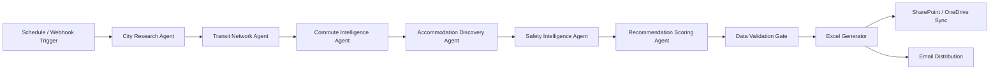

# Agentic AI Travel Intelligence Platform

## Technical Overview
The **Agentic AI Travel Intelligence Platform** is an enterprise-grade automated system designed for Sales, Consulting, GTM, and Leadership teams. It systematically identifies the safest, most cost-effective suburban stay locations with direct commuter rail and metro transit connectivity to downtown central business districts across **11 major US metropolitan regions**.

---

## 🏙️ Supported Metropolitan Regions
1. **New York (NY)**: Midtown / Financial District (MTA Subway, LIRR, Metro-North)
2. **New Jersey (NJ)**: Exchange Place / Newark Downtown (PATH, NJ Transit Rail)
3. **Washington (DC)**: Downtown DC / K Street / Federal Triangle (WMATA Metrorail, VRE, MARC)
4. **Philadelphia (PA)**: Center City / Market East / University City (SEPTA Regional Rail & Subway, PATCO)
5. **Boston (MA)**: Financial District / Back Bay / Seaport (MBTA Subway 'T', Commuter Rail)
6. **Chicago (IL)**: The Loop / River North / West Loop (CTA 'L', Metra Rail)
7. **Dallas (TX)**: Downtown Dallas / Uptown (DART Light Rail, Trinity Railway Express)
8. **Miami (FL)**: Brickell Financial District / Downtown Miami (Miami Metrorail, Brightline, Tri-Rail)
9. **San Francisco (CA)**: Financial District / SOMA / Market Street (BART, Caltrain, Muni Metro)
10. **San Antonio (TX)**: Downtown / River Walk / Central Business District (VIA Metropolitan Transit / Primo)
11. **San Jose (CA)**: Downtown San Jose / Silicon Valley Tech Hub (Caltrain, VTA Light Rail, BART)

---

## 🤖 Multi-Agent Pipeline Architecture


### Agent Roles & Responsibilities:
1. **City Research Agent**: Anchors central business districts, geographical coordinates, and primary transit authorities.
2. **Transit Network Agent**: Discovers commuter rail lines, metro systems, transfer nodes, and standard transit fares.
3. **Commute Intelligence Agent**: Computes door-to-downtown transit duration and enforces the $\le 90$-minute commute constraint.
4. **Accommodation Discovery Agent**: Catalogs budget-friendly stays (Wyndham portfolio, Days Inn, Super 8, Ramada, La Quinta) in the target $\$50-\$60$/night tier near rail stations.
5. **Safety Intelligence Agent**: Quantifies crime indices, neighborhood safety ratings (1-100), and walkability indices.
6. **Recommendation & Ranking Agent**: Computes the multi-criteria composite score:
   $$\text{Overall Score} = (0.35 \times \text{Safety}) + (0.30 \times \text{Cost}) + (0.20 \times \text{Commute}) + (0.15 \times \text{Transit})$$
7. **Data Quality & Validation Agent**: Verifies schema integrity, fare positivity, and bounds before distribution.

---

## 📊 Excel Workbook Structure (`.xlsx`)
The platform outputs a formatted 6-tab Excel workbook:

| Sheet Name | Description | Key Attributes |
| :--- | :--- | :--- |
| **`City_Master`** | Metropolitan anchor reference | `City_ID`, `City`, `State`, `Downtown_District`, `Primary_Transit_System`, `Latitude`, `Longitude`, `Last_Updated` |
| **`Transit_Connectivity`** | Commuter rail & subway corridors | `City`, `Downtown`, `Suburb`, `Transit_System`, `Transit_Mode`, `Nearest_Station`, `Commute_Minutes`, `Transfers`, `Fare_USD` |
| **`Accommodation_Master`** | Budget & transit-adjacent hotels | `City`, `Locality`, `Hotel_Name`, `Address`, `Nightly_Rate_USD`, `Rating`, `Review_Count`, `Distance_To_Station_Miles` |
| **`Safety_Index`** | Neighborhood safety & crime index | `City`, `Locality`, `Safety_Score`, `Crime_Index`, `Walkability`, `Category` |
| **`Recommendation_Score`** | Multi-factor weighted evaluation | `City`, `Locality`, `Safety_Score`, `Cost_Score`, `Commute_Score`, `Transit_Score`, `Overall_Score`, `Rank` |
| **`Final_Output`** | Executive recommendation matrix | `City`, `Downtown`, `Recommended_Locality`, `Transit_System`, `Station`, `Commute_Time`, `Hotel`, `Rate`, `Safety`, `Overall_Score`, `Recommendation` |

---

## 🚀 How to Run

### 1. Python Automation Engine (Standalone)
Execute the end-to-end automation engine via Python:
```powershell
cd C:\Users\nagas\.gemini\antigravity\scratch\travel_intelligence_platform
py travel_intelligence_engine.py
```

### 2. n8n Enterprise Workflow
1. Open your **n8n** instance.
2. Go to **Workflows** > **Import from File**.
3. Select `n8n_workflow_travel_intelligence.json`.
4. Configure your preferred Microsoft SharePoint / OneDrive and Email credentials in the final nodes.
5. Click **Execute Workflow** or activate the Schedule Trigger.
